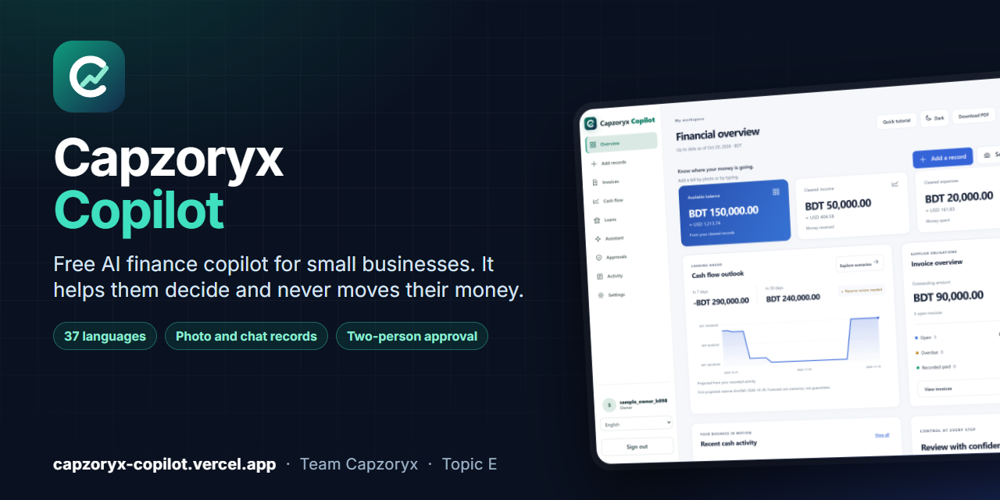
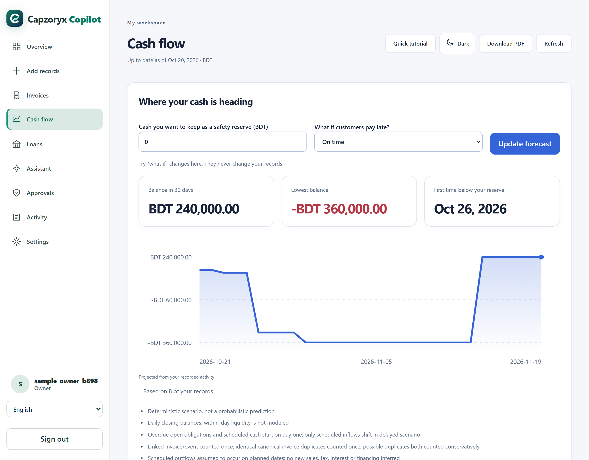
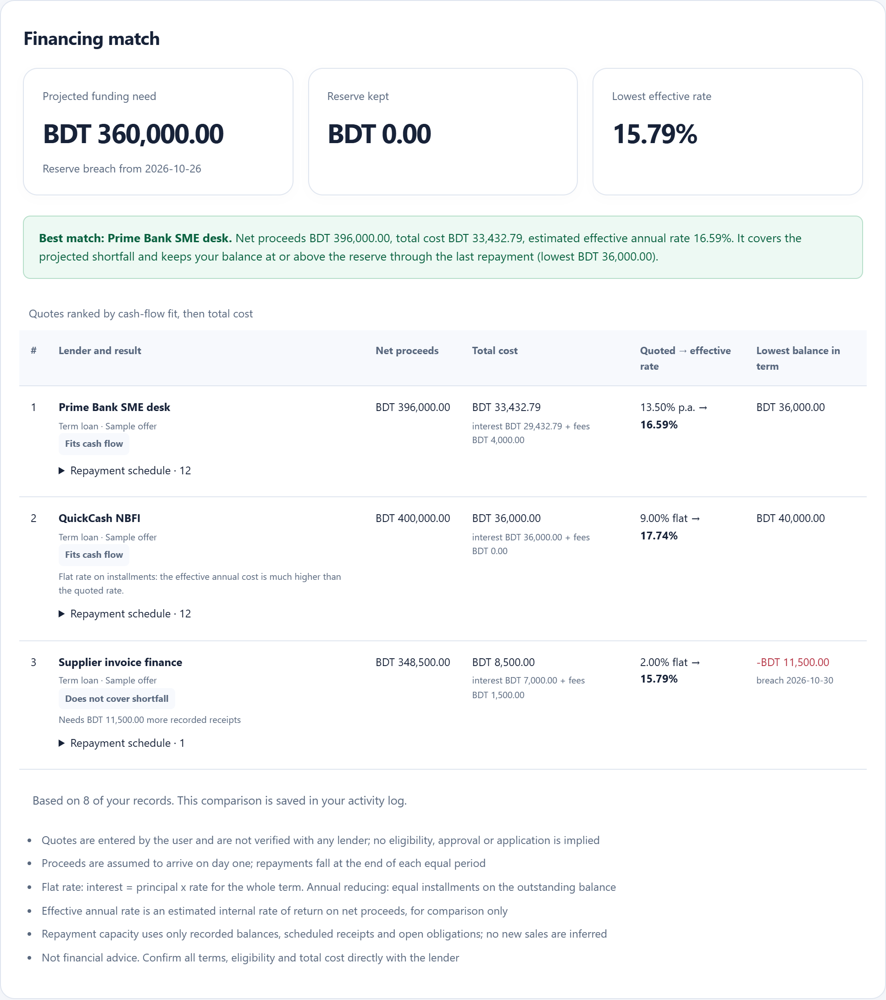
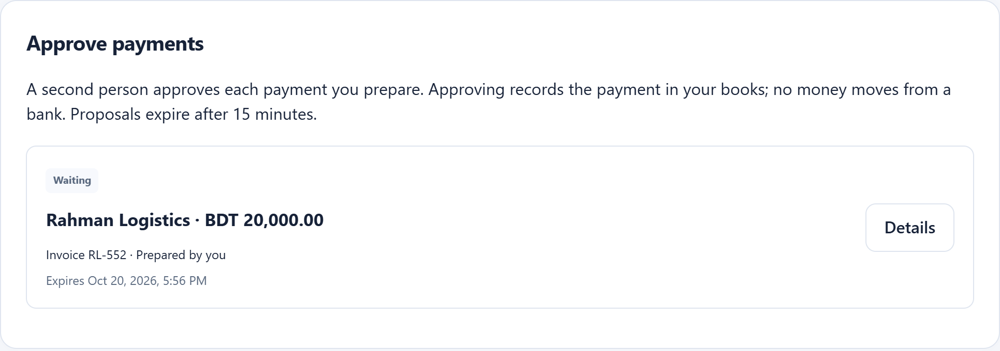

<p align="center">
  
</p>

<h1 align="center">Capzoryx Copilot</h1>

<p align="center"><b>A free, multilingual AI finance copilot for small businesses.</b><br>
It shows when cash will run short, compares loan offers against your own cash flow, and keeps every payment behind a second person's approval. It never moves money.</p>

<p align="center">
  <a href="https://capzoryx-copilot.vercel.app"><b>Try it live</b></a> &nbsp;·&nbsp;
  <a href="submission/Capzoryx_Copilot_Technical_Documentation.pdf">Technical documentation (PDF)</a> &nbsp;·&nbsp;
  <a href="submission/JUDGE_QUICKSTART.md">5-minute walkthrough</a>
</p>

<p align="center">
  <a href="https://github.com/Pranto-404/capzoryx-copilot/actions/workflows/ci.yml"></a>
  
  
  
</p>

<p align="center"></p>

**SME Finance Copilot** by team Capzoryx (Topic E, 2026 Shenzhen International FinTech Competition, International Track).

## Why it is different

- **The AI suggests, people decide.** The model can read a photo or a sentence into a *draft*; the owner confirms it, the server re-validates it, and a different person must approve any payment.
- **Numbers you can check.** Money is exact integers; the 7 and 30 day outlook is deterministic; every posting sits in an append-only ledger with a signed audit chain.
- **Loans compared on the true cost.** Exact schedules and the effective annual rate (fees included), tested against the business's own cash flow, so a low advertised rate cannot hide a bad fit.
- **Local first.** The assistant answers on the device; the online model is optional and only used with permission.
- **Built for real use.** Accounts with two-step sign-in, sharing with roles, PDF reports, 37 languages (including right-to-left) and over 150 currencies with live rates.

Live: https://capzoryx-copilot.vercel.app (the older `safeledger-ai.vercel.app` address has been retired).

<p align="center">
  
  
  
</p>

## What it does

| Area | What it does |
| --- | --- |
| Add records | Photograph a bill or receipt, type it like a message ("I paid Rahman 5000 for freight yesterday"), or fill in a form. You always check a draft before it is saved. |
| Overview | Balance, money received and spent, open bills, pending approvals, an approximate value in your chosen conversion currency (USD by default). |
| Invoices, Cash flow | Unpaid bills and due dates; a deterministic 7/30-day outlook with a safety reserve and what-if scenarios. |
| Loans | Enter real lender offers; exact schedules, effective annual rate, cash-flow fit and a ranked best match. |
| Approvals | A different person approves each payment; approving records it in the books and never sends a bank transfer. |
| Activity | Plain-language history backed by a signed, linked audit chain. |
| Settings | Profile and photo, password change, two-step sign-in (authenticator app and backup codes), email verification and reset codes, workspace sharing with roles, per-currency clear data with 30-day restore, language, conversion currency. |
| Assistant | Answers on the device first (balance, bills, how the site works); smart assist, when on, helps with the rest and reads photos. |
| Reports | A PDF report with balance, bills, cash activity and payment decisions; a full backup file in Settings. |

Interface languages: 37, including Chinese, Japanese, Hindi, Urdu, Arabic and Bangla (right-to-left layouts supported). Over 150 currencies with live exchange rates.

**Coming soon:** import from bank or wallet messages and statement files, a live payment feed for businesses, install on a phone, and bill reminders. Nothing connects to a bank today.

## Architecture

- **Frontend:** React 19 + TypeScript + Vite on Vercel. Strict CSP (`default-src 'self'`, no inline script or style). `/api` is proxied to the backend.
- **Backend:** FastAPI on Render (free tier) with Turso (libSQL over HTTPS) as the database; SQLite locally.
- **Money and approvals:** integer minor units, exact decimals, independent approval, append-only ledger, signed audit chain.
- **Accounts:** scrypt password hashes, server-side sessions in HttpOnly cookies, TOTP two-step sign-in, email codes through a Google Apps Script relay (Render's free tier blocks SMTP), case-insensitive usernames, optional 30-day "Keep me signed in" sessions, browser password-manager support, lockouts that show the wait time and slow an attacked account down rather than locking out its owner, and address-independent rate limits.
- **Translations:** English is the source. A fixed list of interface strings is translated once (Google Translate when `SAFELEDGER_GOOGLE_TRANSLATE_KEY` is set, otherwise the cloud model), cached in the database and exported as static files in `web/public/locales/`.

## Configuration (environment variables on the backend)

| Variable | Purpose |
| --- | --- |
| `SAFELEDGER_SIGNING_KEY` | 64-hex key for signatures and sealed secrets (required in production; never rotate casually). |
| `TURSO_DATABASE_URL`, `TURSO_AUTH_TOKEN` | Persistent database in production. |
| `SAFELEDGER_LLM_*` | Cloud model for smart assist and photo reading (see `docs/FREE_AI_SETUP.md`). |
| `SAFELEDGER_VISION_MODEL` | Optional stronger model for photos; the normal model is the fallback. |
| `SAFELEDGER_MAIL_RELAY_URL`, `SAFELEDGER_MAIL_RELAY_SECRET` | Google Apps Script web app that sends email through your Gmail. |
| `SAFELEDGER_BREVO_API_KEY` / `SAFELEDGER_RESEND_API_KEY` / `SAFELEDGER_SMTP_*` | Alternative mail providers. |
| `SAFELEDGER_MAIL_FROM`, `SAFELEDGER_PUBLIC_URL` | Sender name and the public address used in invitation emails. |
| `SAFELEDGER_GOOGLE_TRANSLATE_KEY` | Optional: Google Cloud Translation for instant new-language translation. |

## Run and verify locally

Python 3.12 and Node 22. Install `api/requirements.txt`, `api/requirements-dev.txt` and `npm ci --prefix web`. Copy `.env.example` and set a private `SAFELEDGER_DB` and `SAFELEDGER_SIGNING_KEY`; never commit secrets.

```sh
python -m pytest api/tests -q
npm run build --prefix web
node scripts/check_local_assistant.cjs && node scripts/check_site_guide.cjs && node scripts/check_record_parser.cjs
node scripts/check_i18n.cjs                           # language helpers: detection, default currency, merge rule
node scripts/extract_ui_strings.cjs --check          # keeps the translatable string list in sync
node scripts/axe_scan.cjs                            # accessibility scan (WCAG 2 A/AA), local app only
python scripts/security_probe.py http://127.0.0.1:8000   # 60 black-box checks, local servers only
python scripts/security_scan.py                       # secret scan over the full git history
```

Two tests are Windows-only failures (POSIX file mode and CRLF line endings) and pass on Linux CI.

## Security

See [SECURITY.md](SECURITY.md) to report a problem, `docs/SECURITY_SELF_ASSESSMENT.md` for controls and limits, and `docs/SECURITY_REVIEW_20261020.md` for the last review. Never run load or probe scripts against the live site; use a local server.

Documentation map: `docs/INDEX.md`; current status and plans: `docs/PROJECT_STATUS.md`, `docs/NEXT_STEPS.md`. Technical documentation (PDF): `submission/Capzoryx_Copilot_Technical_Documentation.pdf`. Judges: `submission/JUDGE_QUICKSTART.md`.

## License

MIT, see [LICENSE](LICENSE). Copyright (c) 2026 Team Capzoryx.
